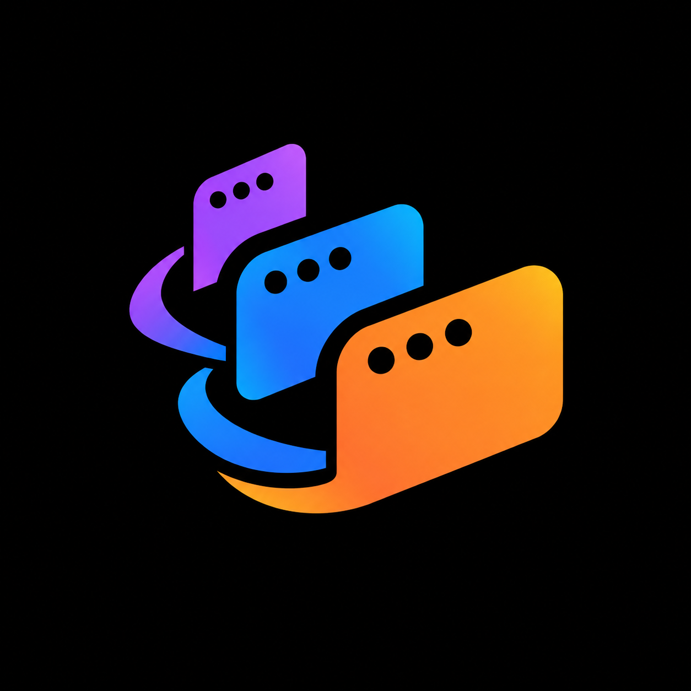

# TabDance

<p align="center"></p>

TabDance is a macOS terminal app built with AppKit and [SwiftTerm](https://github.com/migueldeicaza/SwiftTerm) 1.19.0. It supports multiple windows, workspaces, and live terminal tabs. Each tab runs a login shell with terminal input, ANSI and 256-color output, selection, copy and paste, and resizing.

## Build and run

Requires macOS 13 or later and Xcode 16 or later (Swift 6). Open `TabDance.xcodeproj`, select the `TabDance` scheme, then use **Product > Run** (⌘R). On the first build, allow SwiftTerm's build information plugin when Xcode asks. Use **Product > Test** (⌘U) to run the test suite.

To build a distributable app from the repository root:

```sh
./build-app.sh
open dist/TabDance.app
```

The script builds an ad-hoc signed app for Apple silicon and Intel Macs. Swift Package Manager fetches the pinned SwiftTerm dependency; no other package dependencies are used. Command-line builds skip the interactive approval for that pinned package's build information plugin. The app bundle is named `TabDance.app`; its executable and Swift module retain the name `TerminalLab`.

GitHub Actions builds and tests an Apple silicon (`arm64`) app on pushes to `main`, version tag pushes, pull requests, and manual runs. The `TabDance-macos-arm64` workflow artifact contains a DMG with an Applications shortcut. Successful main pushes, version tag pushes, and manual runs create or update a GitHub release named after the first eight characters of the built commit SHA, with the DMG and a `SHA256SUMS` file. Pull requests produce an ad-hoc signed workflow artifact without publishing a release. Published builds require a Developer ID signature. Notarization is optional; each release states whether its DMG was notarized. To make an arm64 app locally, pass the architecture setting to the build script: `./build-app.sh ARCHS=arm64 ONLY_ACTIVE_ARCH=NO`.

You can also run the package tests with `swift test`, or run the Xcode test scheme from the command line:

```sh
xcodebuild -project TabDance.xcodeproj -scheme TabDance \
  -destination 'platform=macOS' -derivedDataPath .build/xcode \
  -skipPackagePluginValidation test
```

The tests cover PTY, workspace, Codex activity, terminal behavior, and AppKit window behavior. Window layout tests exercise 390×844, 768×1024, 1280×800, and 1440×900 sizes.

The Xcode project is checked in and ready to open. Its configuration lives in
[`project.yml`](project.yml); after changing that file, regenerate the project
with `xcodegen generate` using [XcodeGen](https://github.com/yonaskolb/XcodeGen)
2.44 or later. XcodeGen is only needed to regenerate the project.

For a deterministic test session that skips login profiles and workspace persistence, launch the executable with `--execute`, for example:

```sh
dist/TabDance.app/Contents/MacOS/TerminalLab --execute /bin/sh -c 'printf "TabDance ready\n"; sleep 10'
```

## GitHub release signing

Add these repository or organization secrets for published builds:

- `MACOS_DEVELOPER_ID_P12`: base64-encoded export of the Developer ID Application certificate and private key in a `.p12` archive.
- `MACOS_DEVELOPER_ID_P12_PASSWORD`: the password used to export that archive. The workflow imports it into a temporary keychain and removes the keychain after packaging.

These two secrets sign the app and DMG with Developer ID. They are separate from notarization. To enable notarization, also add all three App Store Connect API key secrets:

- `APPLE_NOTARY_KEY_P8`: the contents of the API key's `.p8` file.
- `APPLE_NOTARY_KEY_ID`: the API key ID.
- `APPLE_NOTARY_ISSUER_ID`: the issuer UUID for the App Store Connect team.

When `APPLE_NOTARY_KEY_P8` is set, Actions requires the key ID and issuer ID too, then notarizes and staples both the app and DMG. Without the p8 secret, notarization is skipped even if the other two values are set. An unnotarized release is still Developer ID signed. To open it, move TabDance to Applications and try opening it. If macOS blocks it, open **System Settings > Privacy & Security**, choose **Open Anyway**, then confirm **Open**. See [Apple's instructions for opening apps safely](https://support.apple.com/en-us/102445). Local `./build-app.sh` builds remain ad-hoc signed and do not use these secrets.

## Workspaces and tabs

Terminal contents use a fixed snapshot of the Ghostty and Rio defaults: Menlo 20 pt, opaque black with green text and cursor, matching selection colors, and the configured 16-color ANSI palette.

The workspace rail shows each workspace's tab count. Every workspace keeps its own live tabs and selected tab; switching workspaces preserves each one's selection. Drag workspace rows to reorder them, or drag tabs within the active workspace. The insertion marker shows where a tab will land, and the tab bar scrolls when dragging near an edge. Tabs can also be reordered with `⌘⌃⇧←` and `⌘⌃⇧→`. Tabs stay in their workspace and window.

Drop local files or folders onto terminal content or a tab label to insert their shell-escaped absolute paths. A drop on an inactive tab selects and focuses it. Paths are separated by spaces and end with a space; TabDance does not press Enter. Drops use bracketed paste when the terminal requests it, and names containing control characters are rejected.

Tab and workspace labels use OSC 7 updates with periodic `libproc` polling as a fallback. Immediately before creating a tab or workspace, TabDance reads the selected shell's process working directory, so a quick `cd` followed by `⌘T` or `⌘⇧N` starts the new shell there. Directory labels follow Rio's naming style.

Below 600 points of window width, the workspace rail collapses and the workspace menu button remains available. `⌘B` toggles the wider sidebar.

## Keyboard shortcuts

| Shortcut | Action |
| --- | --- |
| `⌘T` | New tab |
| `⌘⇧N` | New workspace |
| `⌘N` | New window |
| `⌘W` | Close tab |
| `⌘⇧W` | Close window |
| `⌘⇧[` / `⌘⇧]` | Select previous / next tab |
| `⌃Tab` / `⌃⇧Tab` | Select next / previous tab |
| `⌘1`–`⌘8` | Select tab 1–8 in the active workspace |
| `⌘9` | Select the last tab in the active workspace |
| `⌥⌘↑` / `⌥⌘↓` | Select previous / next workspace |
| `⌘B` | Toggle the sidebar |
| `⌘⌃⇧←` / `⌘⌃⇧→` | Move the selected tab left / right |
| `⌘K` | Clear output above the current logical command line |

## State and terminal behavior

Holding a key repeats terminal input using the macOS keyboard repeat rate and delay.

The primary window saves its layout, tab directories and titles, and selections to `~/Library/Application Support/TabDance/workspaces.json`. Restoring that layout starts new shells; it does not restore running processes, shell history, or commands. Secondary windows do not overwrite the primary window's saved layout. Launching with `--execute` skips persistence.

`⌘K` clears prior output and scrollback while keeping the current logical command line at the cursor, including wrapped lines. It does not send `Ctrl-L`. Selecting text automatically copies it to the clipboard. Drag selection stays active while terminal output redraws, and a snapshot preserves the selected text for `⌘C` even if it is later erased. Explicit input or a mouse clear discards the snapshot. Plain left-button click and drag selects text even when an app requests mouse input; use `⌥`-click or `⌥`-drag to send left-button input to the app.

The Codex activity indicator follows Codex task events found under each shell's process tree and session transcript. An idle Codex process does not show as busy. `Ctrl-C` cancels the indicator, and bracketed paste contents do not count as submitted prompts.

## Scope

TabDance is a prototype, not a clone of Apple Terminal. It has no profiles, search, or preferences. Shells run without the macOS App Sandbox because a general-purpose local terminal needs normal filesystem and process access. ⌘W closes the selected tab immediately, and ⌘Q quits immediately; closing a window explicitly asks for confirmation when sessions are active. Third-party license text ships inside the app bundle. SwiftTerm is pinned to 1.19.0 (`464df5207fc2432e16c9a23abe538187196daf5f`). Exact copied-newline behavior and latency parity with Apple Terminal have not been measured.

## Apple Terminal analysis

[`analysis/`](analysis/) contains static extraction artifacts for an Apple Terminal Mach-O executable, including Objective-C metadata, method indexes, call data, and per-method disassembly. The extraction script is [`analysis/extract.py`](analysis/extract.py). It uses Python 3 and macOS tools such as `lipo`, `otool`, `nm`, and `dyld_info`.

Before running the script, update its hardcoded `SOURCE` path to a Mach-O executable with an arm64e slice. It also reads the installed Terminal app at `/System/Applications/Utilities/Terminal.app`. From the repository root, run:

```sh
python3 analysis/extract.py
```

Running it regenerates files under `analysis/`, including raw tool output, so review the destination before running it.

## License

This repository is distributed under the [GNU General Public License, version 3](LICENSE). TabDance's bundled SwiftTerm license text is in [`THIRD_PARTY_LICENSES.txt`](THIRD_PARTY_LICENSES.txt).
